# Awesome-Accounting-Integration-Sync ⚡📊

  

  
  
  
  
  
  

---

> **The Curated Directory of SaaS Integration Platforms & Open-Source Accounting Sync Frameworks** 🌟
>
> An authoritative reference for software architects, finance engineering teams, and integration specialists automating ERP, CRM, and ledger workflows across QuickBooks, NetSuite, Xero, Zoho, and Sage.

---

## 📌 Table of Contents 📑

- [🌟 Sector Overview & Market Dynamics](#-sector-overview--market-dynamics)
- [🏢 SaaS & Hosted Integration Platforms](#-saas--hosted-integration-platforms)
- [💻 Open-Source GitHub Projects & Sync Frameworks](#-open-source-github-projects--sync-frameworks)
- [📊 Architectural Comparison: Sync Approaches](#-architectural-comparison-sync-approaches)
- [📈 Star History](#-star-history)
- [🤝 How to Contribute](#-how-to-contribute)
- [💖 Support & Sponsorship](#-support--sponsorship)
- [⚖️ Disclaimer & Compliance](#-disclaimer--compliance)

---

## 🌟 Sector Overview & Market Dynamics 📈

The global **Integration Platform as a Service (iPaaS) and accounting data integration market** is estimated at **$8.5B to $19.1B** (scaling toward **$100B+** by the mid-2030s at an aggressive **12% to 24% CAGR**), while the underlying **core accounting software** sector represents an additional **$20B+** addressable base. 

Structurally, the market presents a **two-tier dynamic**:
1. **Core Accounting Ledgers (Moderately Concentrated):** Dominant mega-vendors (Intuit QuickBooks, Oracle NetSuite, Xero, Sage) anchor the primary general ledgers.
2. **Integration & Sync Middleware (Highly Fragmented):** Unlike winner-take-all enterprise software verticals, the sync and ETL middleware layer is **highly fragmented**. Organizations juggle wildly heterogeneous stacks across CRMs (Salesforce, HubSpot, Zoho), POS systems, e-commerce engines, and data warehouses, preventing a single platform from monopolizing the space and creating immense demand for open-source connectors, horizontal iPaaS solutions, and specialized data pipelines.

---

## 🏢 SaaS & Hosted Integration Platforms ☁️

*Commercial platforms providing managed connectors, visual workflows, ELT pipelines, and bidirectional ledger synchronization.*

| Platform | Company Size (Valuation / Revenue) | Pricing | Free Tier / Limits | Description & Best For | Trade-offs |
| :--- | :--- | :--- | :--- | :--- | :--- |
| **Zoho CRM Native QuickBooks Integration** | **~$12B – $12.5B valuation** / ~$1.4B – $1.5B revenue (Zoho Corp) | Included with Zoho CRM and QuickBooks subscriptions | Free with active CRM/QBO plans (Zoho CRM offers free tier up to 3 users) | Native two-way sync for Contacts, Accounts, Vendors, Products; one-way sync (QuickBooks → CRM) for financial docs (Invoices, Estimates, POs). Best for Zoho CRM users wanting no-middleware sync. | Limited strictly to Zoho CRM + QuickBooks Online pairing. |
| **Workato** | **$5.7B valuation** (Series E) / ~$150M – $188M ARR | Quote-only (custom enterprise plans based on recipes/connections) | Trial available upon request; no permanent free tier | Enterprise automation platform with recipe-based accounting workflows and governance. Best for enterprise IT and finance operations. | High minimum spend; requires integration expertise. |
| **Fivetran** | **$5.6B valuation** / ~$300M+ ARR | Consumption-based (Monthly Active Rows - MAR); free deletes and re-syncs | 14-day free trial; free tier available for very low volume (up to 500k MAR/mo) | Managed ELT data movement with deep NetSuite & NetSuite 2 connectors, schema drift handling, and dbt packages. Best for analytics data warehousing. | ELT only (extract & load to warehouse); no bidirectional write-back. |
| **Zapier** | **$5.0B valuation** / ~$310M+ ARR | Free tier available; paid plans start at $19.99/mo (billed annually) | Free tier available: 100 tasks/month, single-step Zaps, 15-minute update interval | Visual no-code workflow automation connecting QuickBooks, Xero, FreshBooks, and 7,000+ apps. Best for simple trigger-action automations without code. | Task limits consume quickly at high sync volumes; lacks native reconciliation engine. |
| **Make (Celonis)** | **~$13B parent valuation (Celonis)** / ~$50M – $100M ARR (Make standalone) | Free tier available; Core starts at $9/mo, Pro at $16/mo | Free tier available: 1,000 operations/month, 100MB data transfer, 15-minute intervals | Visual flow-based iPaaS with granular control and connectors to major accounting software. Best for complex multi-step automations and logic. | Steeper learning curve than Zapier; operation counting requires careful optimization. |
| **Stitch (Qlik / Talend)** | **Acquired for $60M** (Talend later acquired for $2.4B by Thoma Bravo/Qlik) | Standard plans start at $100/mo (tiered by row volume) | 14-day free trial; no permanent free tier | Developer-friendly cloud ETL with accounting sources (Sage Intacct, etc.) replicating to data warehouses. Best for developer-driven warehouse loads. | Pipeline/ETL only; no bidirectional sync or write-back to source accounting systems. |
| **Celigo** | **$500M+ est. valuation** ($80M+ funding) / ~$95M – $100M+ ARR | Quote-only (annual subscription based on endpoints and flows) | Free trial available; no permanent free tier | iPaaS built for NetSuite, ERPs, and e-commerce ecosystems with pre-built business process templates. Best for NetSuite-centric mid-market to enterprise businesses. | Tailored heavily toward NetSuite/ERP ecosystems; custom quotes required. |
| **OneSaaS (Intuit QuickBooks Connector)** | **Acquired by Intuit** ($91B+ market cap / ~$21B revenue) | Basic ~$29/mo, Premium ~$49/mo, Unlimited ~$99/mo | 7-day free trial; no permanent free tier | E-commerce and CRM data integration connector bridging WooCommerce, Shopify, BigCommerce to QuickBooks Online. Best for SMB e-commerce sync. | Plan tiers enforce caps on sync volume and number of connected apps. |
| **Dataddo** | **~$3.2M ARR** (Private / Bootstrapped/Seed) | Usage/consumption-based and custom tiers | 14-day free trial; limited free tier available | Managed data pipeline platform supporting Sage Business Cloud Accounting and analytics destinations. Best for automated warehouse feeds. | Analytics pipeline-oriented; lacks bidirectional CRM-to-accounting reconciliation. |
| **SyncApps by Cazoomi** | **~$440K ARR** (Private / Bootstrapped) | Flat rate: **$150/month** (all features, unlimited records, 24/7 human support) | Free trial available; no permanent free tier | Flat-rate bidirectional integration platform syncing Salesforce, NetSuite, Zoho, Dynamics 365, and HubSpot. Best for SMBs with high transaction volumes. | Flat rate may not be cost-effective for very low sync volumes. |

---

## 💻 Open-Source GitHub Projects & Sync Frameworks 🛠️

*Open-source libraries, protocol connectors, ELT pipelines, and self-hosted accounting engines sorted in descending order of GitHub stargazers.*

| Project | GitHub_Stars | Focus & Description | Tech Stack | License | Deployment |
| :--- | :---: | :--- | :--- | :--- | :--- |
| **[ERPNext](https://github.com/frappe/erpnext)** |  | Complete open-source ERP system featuring general ledger, automated reconciliation, and extensive REST sync APIs. | Python / Frappe / JS | GPL-3.0 | Self-hosted / Frappe Cloud |
| **[Airbyte](https://github.com/airbytehq/airbyte)** |  | Open-source ELT data pipeline engine featuring native connectors for QuickBooks Online, Sage, Stripe, and warehouses. | Java / Python / React | MIT / ELv2 | Docker / Kubernetes |
| **[Nango](https://github.com/NangoHQ/nango)** |  | Unified API and integration platform with pre-built continuous sync integrations for accounting (QuickBooks, Xero, NetSuite). | TypeScript / Node.js | AGPL-3.0 | Self-hosted / Cloud |
| **[Akaunting](https://github.com/akaunting/akaunting)** |  | Free and open-source online accounting software built for small businesses with rich modular app sync architecture. | PHP / Laravel / Vue.js | GPL-3.0 | Self-hosted / Docker |
| **[Kill Bill](https://github.com/killbill/killbill)** |  | Open-source subscription billing, payment, and financial ledger platform built for real-time invoice/payment event synchronization. | Java | Apache-2.0 | Self-hosted / Cloud |
| **[Meltano](https://github.com/meltano/meltano)** |  | Declarative CLI-first data engineering framework running Singer taps (including `tap-quickbooks`) to extract and sync accounting data. | Python | MIT | Local / Docker / Cloud |
| **[financial-datasets MCP Server](https://github.com/financial-datasets/mcp-server)** |  | Model Context Protocol (MCP) server providing financial datasets, statements, and ledger insights directly to AI agents. | Python / TypeScript | MIT | MCP Client (Claude / Cursor) |
| **[django-ledger](https://github.com/arrobalytics/django-ledger)** |  | Double-entry accounting and financial analysis engine on Django, ideal as a self-hosted custom ledger sync target. | Python / Django | MIT | Pip package / Django app |
| **[QuickBooks Python Client](https://github.com/routablehq/python-quickbooks)** |  | The standard Python library for connecting to Intuit QuickBooks Online API v3 with complete CRUD, batching, and OAuth 2.0. | Python | MIT | Pip package |
| **[QuickBooks V3 PHP SDK](https://github.com/intuit/QuickBooks-V3-PHP-SDK)** |  | Official Intuit PHP SDK for accessing QuickBooks Online REST APIs, handling entity synchronization and token management. | PHP | Apache-2.0 | Composer package |
| **[Singer tap-quickbooks](https://github.com/singer-io/tap-quickbooks)** |  | Open-source Singer.io specification tap pulling invoices, accounts, and payments from QuickBooks Online. | Python | Apache-2.0 | Singer runner / Meltano |
| **[QuickBooks Sync Reliability Lab](https://github.com/me-Shahsavan/quickbooks-sync-reliability-lab)** |  | Failure-mode testbench and SRE runbook catalog for hardening mission-critical QuickBooks Online sync pipelines. | Shell / Python | MIT | Self-hosted test suite |
| **[QuickBooks Master Sync for ERPNext](https://github.com/invento-software-limited/quickbooks_master_sync)** |  | Dedicated open-source Frappe/ERPNext app to sync and migrate chart of accounts, customers, vendors, and balances from QBO. | Python / Frappe | MIT | Frappe App |

---

## 📊 Architectural Comparison: Sync Approaches 🔄

When selecting an architecture for syncing accounting data, keep these fundamental patterns in mind:

1. **Bidirectional Sync Platforms (e.g., SyncApps, Zoho CRM Native, Zapier, Make, Workato):**
   * Keep source and destination ledgers/CRMs continuous and synchronized in both directions.
   * Handle record conflict resolution, deduplication, and status callbacks.
2. **Managed ELT / ETL Pipelines (e.g., Airbyte, Meltano, Fivetran, Stitch, Dataddo):**
   * Extract financial transactions to data warehouses (Snowflake, BigQuery, Databricks).
   * Unidirectional by design; optimal for analytics, financial reporting, and audits rather than operational write-backs.
3. **AI Agent Interfaces & MCP Servers (e.g., financial-datasets MCP Server):**
   * Expose transactional and reporting tools to AI agents (Claude, Cursor, Codex).
   * Enable natural-language reconciliation and autonomous accounting workflows.
4. **Self-Hosted Double-Entry Engines (e.g., ERPNext, Akaunting, django-ledger):**
   * Provide the target ledger with strict audit trails, debit/credit integrity, and chart-of-accounts structure.

---

## 📈 Star History

---

## 🤝 How to Contribute 🚀

Contributions are warmly welcome! Help make this the most comprehensive and accurate directory for accounting integration and sync:

1. 🍴 **Fork the repository**.
2. 🌿 **Create a new branch** (`git checkout -b feature/add-new-sync-tool`).
3. 📝 **Add/edit entries in [`README.md`](file:///C:/Users/ishan/Documents/Projects/Awesome-Accounting-Integration-Sync/README.md)** following the existing table formatting:
   - Provide platform/repo name, official links, concise description, pricing/license, and Stars_Badge.
4. 📬 **Submit a Pull Request** with a clear explanation of why the tool is valuable for accounting integration.

---

## 💖 Support & Sponsorship ☕

Thank you for exploring and using **Awesome-Accounting-Integration-Sync**! If this curated collection helps streamline your financial pipelines, save integration hours, or architect better systems:

- ⭐ **Star the repository** to boost visibility for the developer community!
- 🍴 **Fork and share** with fellow engineers, CFOs, and integration specialists.
- ☕ **Buy me a coffee / Sponsor the project**: Contributions directly support ongoing research, maintenance, and curation of developer-friendly integration resources.

👉 **Support via GitHub Sponsors:** [**Sponsor @ishandutta2007 on GitHub**](https://github.com/sponsors/ishandutta2007)

---

## ⚖️ Disclaimer & Compliance 🛡️

- This repository is a **community-curated guide** intended for informational and architectural evaluation purposes only.
- **Financial Compliance & Data Protection:** Financial data movements are subject to stringent regional regulations (GDPR, CCPA, SOC 2, HIPAA, SOX). Ensure that appropriate end-to-end encryption, strict role-based access controls (RBAC), and immutable audit logs are active on all production sync connectors.
- Commercial trademarks (QuickBooks, NetSuite, Xero, Sage, Zoho, etc.) belong to their respective corporate owners.

---

  <b>Built with ❤️ for finance teams, integration architects, and data engineers worldwide.</b> 
  <i>Let's make financial data integration seamless, transparent, and resilient.</i>

